### Escuela Colombiana de Ingeniería
### Arquitecturas de Software - ARSW

## Escalamiento en Azure con Maquinas Virtuales, Sacale Sets y Service Plans

### Dependencias
* Cree una cuenta gratuita dentro de Azure. Para hacerlo puede guiarse de esta [documentación](https://azure.microsoft.com/es-es/free/students/). Al hacerlo usted contará con $100 USD para gastar durante 12 meses.
Antes de iniciar con el laboratorio, revise la siguiente documentación sobre las [Azure Functions](https://www.c-sharpcorner.com/article/an-overview-of-azure-functions/)

### Parte 0 - Entendiendo el escenario de calidad

Adjunto a este laboratorio usted podrá encontrar una aplicación totalmente desarrollada que tiene como objetivo calcular el enésimo valor de la secuencia de Fibonnaci.

**Escalabilidad**
Cuando un conjunto de usuarios consulta un enésimo número (superior a 1000000) de la secuencia de Fibonacci de forma concurrente y el sistema se encuentra bajo condiciones normales de operación, todas las peticiones deben ser respondidas y el consumo de CPU del sistema no puede superar el 70%.

### Escalabilidad Serverless (Functions)

1. Cree una Function App tal cual como se muestra en las  imagenes.

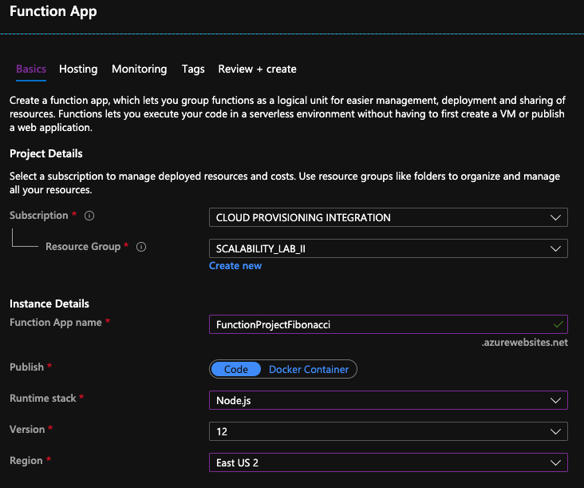

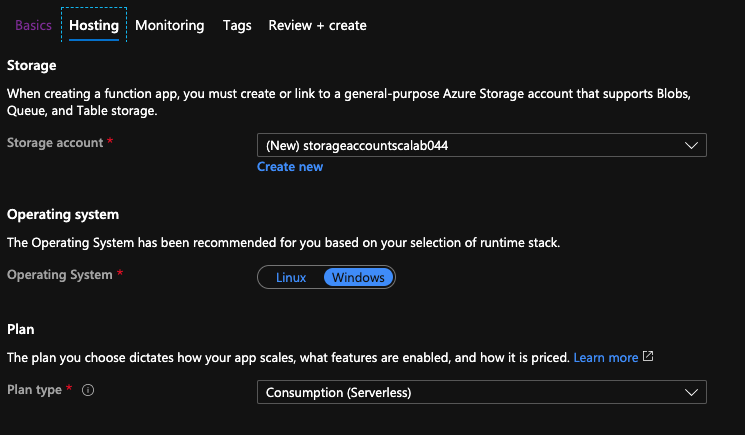

2. Instale la extensión de **Azure Functions** para Visual Studio Code.

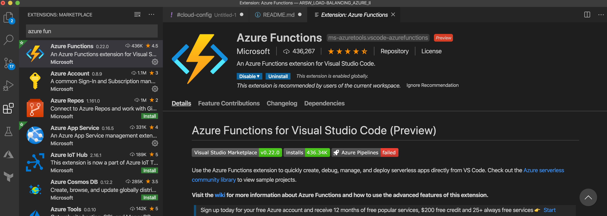

3. Despliegue la Function de Fibonacci a Azure usando Visual Studio Code. La primera vez que lo haga se le va a pedir autenticarse, siga las instrucciones.

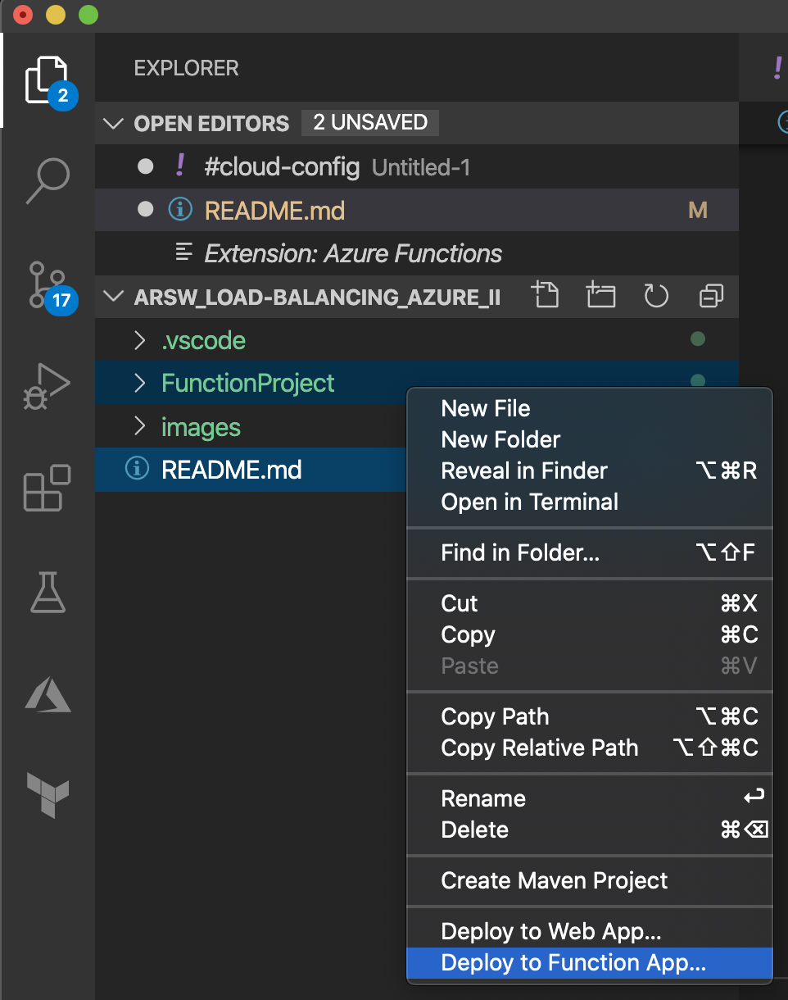

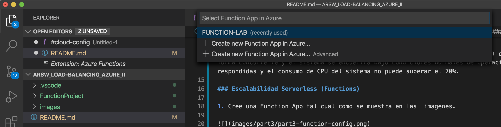

4. Dirijase al portal de Azure y pruebe la function.

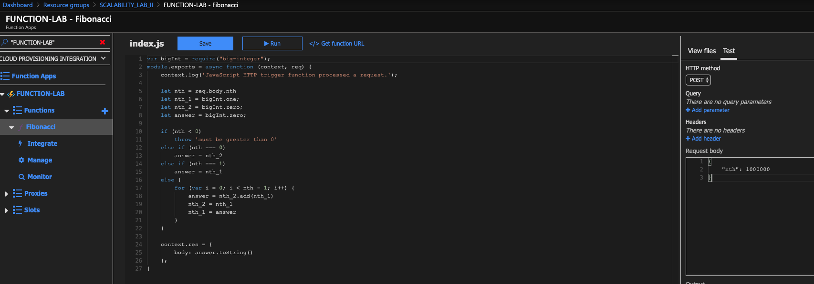

5. Modifique la coleción de POSTMAN con NEWMAN de tal forma que pueda enviar 10 peticiones concurrentes. Verifique los resultados y presente un informe.

6. Cree una nueva Function que resuleva el problema de Fibonacci pero esta vez utilice un enfoque recursivo con memoization. Pruebe la función varias veces, después no haga nada por al menos 5 minutos. Pruebe la función de nuevo con los valores anteriores. ¿Cuál es el comportamiento?.

**Preguntas**

* ¿Qué es un Azure Function?
* ¿Qué es serverless?
* ¿Qué es el runtime y que implica seleccionarlo al momento de crear el Function App?
* ¿Por qué es necesario crear un Storage Account de la mano de un Function App?
* ¿Cuáles son los tipos de planes para un Function App?, ¿En qué se diferencias?, mencione ventajas y desventajas de cada uno de ellos.
* ¿Por qué la memoization falla o no funciona de forma correcta?
* ¿Cómo funciona el sistema de facturación de las Function App?
* Informe

---

## Solución e informe

### Entorno desplegado

| Elemento | Valor |
|---|---|
| Function App | `FunctionProjectFibonacci33284` (el nombre del enunciado ya no era único, se agregó un sufijo) |
| Grupo de recursos | `SCALABILITY_LAB_II` |
| Región | East US 2 |
| Sistema operativo y plan | Windows, Consumption (Y1) |
| Runtime | Node.js 24, Functions v4 |
| Funciones | `Fibonacci` (iterativa) y `FibonacciMemo` (recursiva con memoization) |

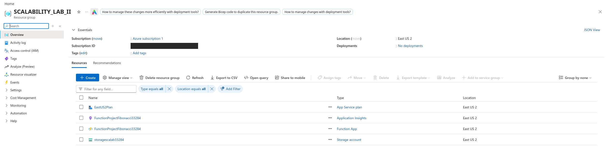

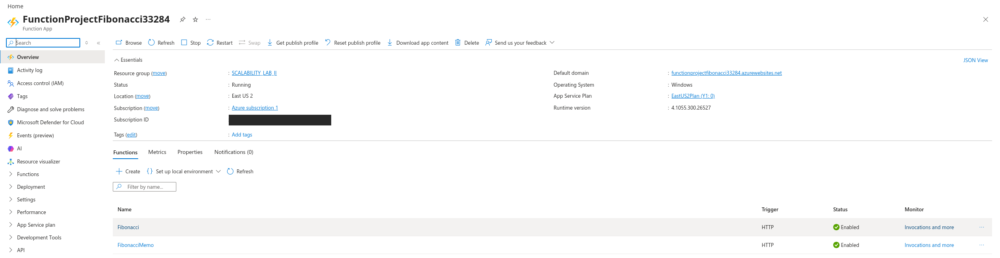

**Diferencias con el enunciado**

* Azure ya no ofrece Node.js 12 para Function Apps, por lo que se usó Node.js 24. Esto obligó a actualizar el extension bundle de `host.json` a `[4.*, 5.0.0)` y a excluir `proxies.json` del paquete.
* El despliegue se hizo con Azure CLI (`az functionapp deployment source config-zip`) en lugar de la extensión de Visual Studio Code.
* El repositorio no incluía una colección de Postman, así que se creó una en `postman/`.

### Prueba desde el portal (paso 4)

Se probó `Fibonacci` desde **Code + Test > Test/Run** con el método POST y el body `{ "nth": 10 }`. La función respondió `200 OK` con el valor `55`.

Al principio el portal devolvió `0 Unknown HTTP error`, porque la Function App no aceptaba peticiones de ese origen. Se resolvió agregando `https://portal.azure.com` a los orígenes permitidos de CORS.

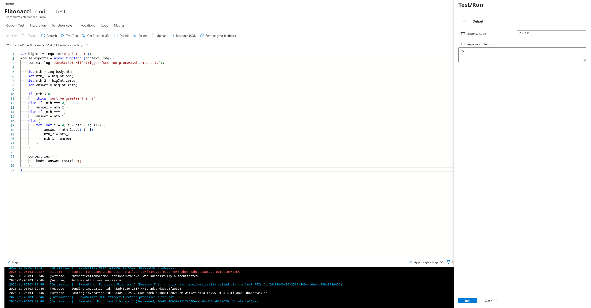

*La línea roja `Failed` de las 03:39:27 pertenece a un intento anterior. La prueba mostrada es la de las 03:39:46, que termina en `Succeeded`.*

### Prueba de carga con Newman (paso 5)

Se ejecutaron 10 procesos de Newman en paralelo con `postman/run-concurrent.sh`, consultando `n = 1.000.000` en la función iterativa. Los datos están en `postman/results/newman-10-concurrentes.txt`.

```bash
BASE_URL=https://<app>.azurewebsites.net ./postman/run-concurrent.sh Fibonacci 1000000 10
```

| Medida | Resultado |
|---|---|
| Una petición sola (línea base) | 7,39 s |
| Peticiones concurrentes exitosas | 10 de 10 |
| Tiempo mínimo | 61,2 s |
| Tiempo medio | 70,2 s |
| Tiempo máximo | 72,6 s |
| Instancias que atendieron las peticiones | 1 (`214afe76`) |
| CPU durante la carga (`% Processor Time`) | 100% a las 02:52:05 UTC (50% normalizado) |

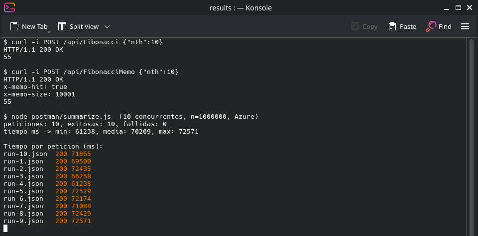

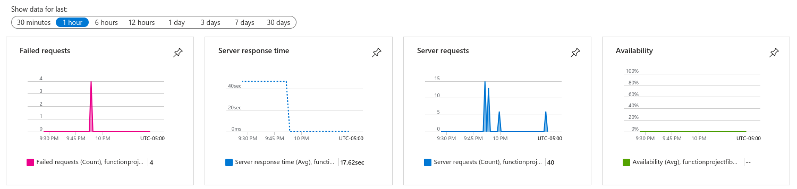

*Gráficas de la última hora: peticiones fallidas (las 4 pruebas de límite de memoization), tiempo de respuesta y peticiones atendidas. La gráfica Availability no indica una caída: marca `--` porque no se configuraron pruebas de disponibilidad.*

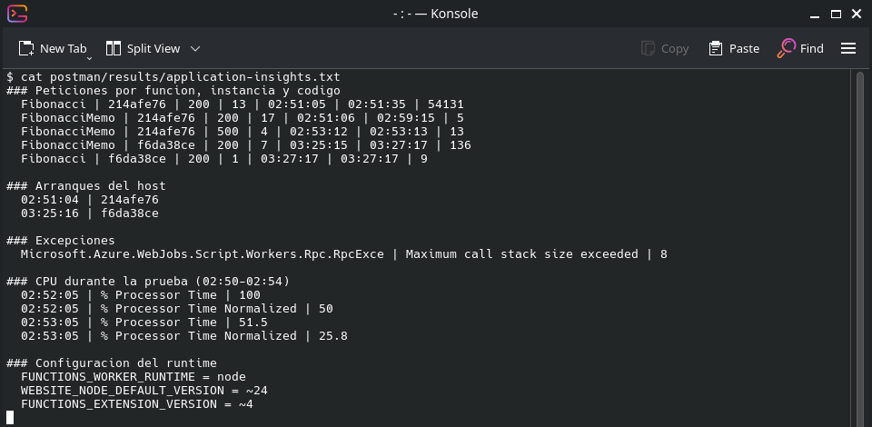

*Datos consultados en Application Insights, guardados en `postman/results/application-insights.txt`. Las columnas de peticiones son: función, instancia, código HTTP, cantidad, hora de la primera, hora de la última y duración media en ms. Las horas están en UTC.*

**Análisis**

* **Disponibilidad:** se cumple la primera parte del escenario, porque todas las peticiones fueron respondidas.
* **Tiempo de respuesta:** las 10 peticiones tardaron casi 10 veces lo que tarda una sola (7,39 s x 10 = 73,9 s). Application Insights muestra que todas pasaron por una única instancia. La explicación más probable es que el cálculo ocupa por completo el hilo de Node.js y las peticiones se atienden una tras otra.
* **Escalamiento:** durante los 72 s de la prueba la plataforma no agregó instancias, así que para esta carga corta el escalamiento automático no redujo los tiempos.
* **CPU:** el resultado no es concluyente frente al límite del 70%. Application Insights registró dos muestras, una por minuto: 100% de `% Processor Time` (50% normalizado) a las 02:52:05 UTC y 51,5% (25,8% normalizado) a las 02:53:05 UTC. La medida normalizada, que reparte el uso entre todos los núcleos, queda por debajo del 70%, pero la medida sin normalizar llegó al 100%. Esto coincide con un núcleo saturado por el hilo de Node.js. Con dos muestras no se conoce el pico real.

### Memoization (paso 6)

La función `FibonacciMemo` guarda los resultados en una variable a nivel de módulo. Las cabeceras `x-memo-hit` y `x-memo-size` indican si el valor ya estaba en caché y cuántas entradas tiene. Los datos completos están en `postman/results/memoization-idle-test.log`.

| Momento | Resultado |
|---|---|
| Primera consulta de un valor nuevo | `hit=false`, se calcula y se guarda |
| Consultas repetidas | `hit=true`, responde desde la caché |
| Tras 6 minutos sin uso | `hit=true`, conserva las 10.001 entradas |
| Tras unos 32 minutos sin uso | `hit=false`, la caché vuelve a empezar y la primera petición tarda 1,74 s (normalmente unos 0,25 s) |
| n = 20.000, 50.000, 100.000 y 1.000.000 | Error 500 por `RangeError: Maximum call stack size exceeded` |

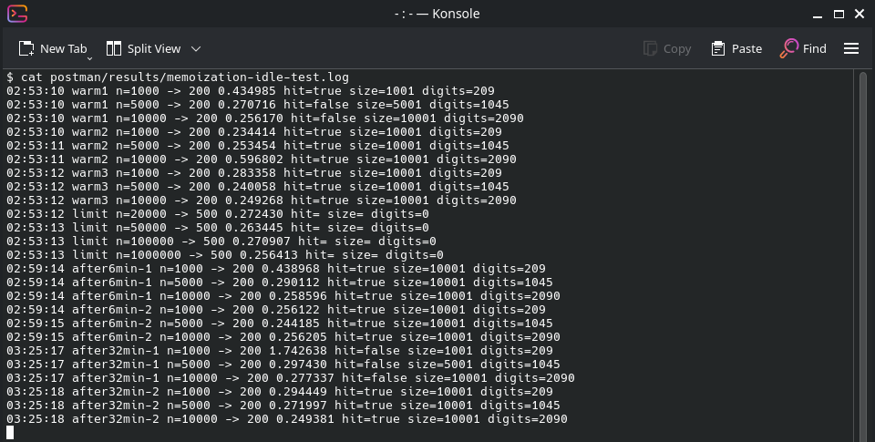

La causa de los errores 500 y el cambio de instancia se ven en la captura de datos de Application Insights de la sección anterior.

**Comportamiento observado:** la espera de 5 minutos pedida en el enunciado no borró la caché, porque la instancia seguía activa. Con una espera más larga el host arrancó en otra instancia (`214afe76` pasó a `f6da38ce` a las 03:25:16 UTC) y la caché quedó vacía. El tiempo que tarda Azure en liberar una instancia no es fijo, por lo que con otra prueba el resultado a los 5 minutos podría ser distinto.

### Preguntas

**¿Qué es un Azure Function?**

Es un servicio de Azure para ejecutar pequeñas piezas de código en respuesta a un evento o trigger, como una petición HTTP, un temporizador o un mensaje en una cola. El desarrollador escribe la función y Azure se encarga de la infraestructura donde corre.

**¿Qué es serverless?**

Es un modelo en el que el proveedor administra los servidores, el aprovisionamiento y el escalamiento. Los servidores siguen existiendo, pero el equipo no los gestiona. Normalmente se paga por el uso real y la aplicación puede bajar a cero instancias cuando no recibe tráfico.

**¿Qué es el runtime y qué implica seleccionarlo al momento de crear el Function App?**

Es el entorno que ejecuta las funciones: el lenguaje y su versión (en este lab, Node.js) junto con la versión del host de Azure Functions. Elegirlo define en qué lenguaje se escribe el código, qué APIs y extensiones se pueden usar, qué sistemas operativos y planes están disponibles, y hasta cuándo tendrá soporte. Este lab lo demuestra: Node.js 12 ya no se ofrece, y pasar a una versión soportada obligó a cambiar la configuración del proyecto.

**¿Por qué es necesario crear un Storage Account de la mano de un Function App?**

Porque el host de Functions lo usa para su propio funcionamiento: guarda las claves de las funciones, coordina los triggers y las instancias, mantiene el estado interno y, en planes como Consumption en Windows, almacena el código de la aplicación en un recurso compartido de archivos.

**¿Cuáles son los tipos de planes para un Function App?, ¿En qué se diferencian?, mencione ventajas y desventajas de cada uno de ellos.**

| Plan | Funcionamiento | Ventajas | Desventajas |
|---|---|---|---|
| Consumption | Escala de forma automática y se paga por ejecución | Bajo costo con poco tráfico, nivel gratuito, escala a cero | Arranques en frío, tiempo de ejecución limitado, sin integración con redes privadas |
| Flex Consumption | Serverless con instancias siempre listas opcionales | Escalado rápido, redes privadas, control de memoria | Solo en Linux y con regiones limitadas; las instancias siempre listas cuestan aunque no se usen |
| Premium | Instancias precalentadas con escalado automático | Sin arranques en frío, redes privadas, ejecuciones más largas | Hay un costo mínimo permanente aunque no haya tráfico |
| Dedicated (App Service) | Corre sobre un App Service Plan con máquinas reservadas | Costo predecible, se aprovecha un plan existente, sin límite estricto de duración | Se paga aunque esté inactivo, escalamiento menos elástico |
| Container Apps | Funciones en contenedores sobre Azure Container Apps | Control del contenedor y sus dependencias, convive con microservicios | Mayor complejidad de configuración y operación |

**¿Por qué la memoization falla o no funciona de forma correcta?**

Por tres razones, todas observadas o derivadas de este lab:

1. **La memoria no es persistente.** La caché vive en la memoria del proceso. Cuando Azure libera la instancia se pierde, como ocurrió tras unos 32 minutos.
2. **La memoria no se comparte.** Cada instancia tiene su propia caché, así que al escalar a varias instancias una petición puede caer en una que no tiene el valor. Para compartirla haría falta un almacenamiento externo, como Redis.
3. **La recursión tiene un límite.** Para calcular un valor lejano de lo que ya está en caché hay que apilar una llamada por cada número que falta. En Azure, pasar de 10.000 a 20.000 ya desbordó la pila, así que `n = 1.000.000`, el valor del escenario de calidad, no se puede calcular con este enfoque.

**¿Cómo funciona el sistema de facturación de las Function App?**

Depende del plan. En Consumption se cobra por número de ejecuciones y por recursos consumidos, medidos en GB-segundos (memoria usada multiplicada por el tiempo de ejecución), con un nivel gratuito mensual de 1 millón de ejecuciones y 400.000 GB-s. En Premium y Dedicated se paga por las instancias reservadas, se usen o no. Aparte se cobran los servicios asociados, como el Storage Account y Application Insights.

### Conclusiones

* La solución serverless respondió todas las peticiones, pero una carga corta y muy intensiva en CPU no se benefició del escalamiento: las peticiones se acumularon en una sola instancia y un núcleo llegó a saturarse.
* La memoization en memoria no es confiable en serverless. Solo ayuda mientras la instancia siga viva y para valores cercanos a los ya calculados.
* Para este escenario el enfoque iterativo es la mejor opción de las dos, porque es el único que calculó `n = 1.000.000`.
